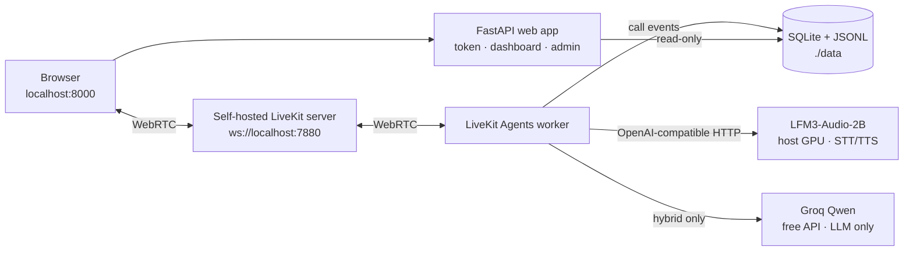

# Forge Voice

**An open-source, local-first voice agent that books home-services calls and proves its own
safety, handoff and monitoring layers with a reproducible evaluation.**

**Who it is for:** home-services operators who want a narrow first slice with real safety and
handover; agencies that want a reusable two-tenant engine; and engineers who want to inspect the
evaluation and monitoring layers, not just a prompt.

**Status:** `evaluated · demo local`. The demo assets are complete. The local text safety run
passes every hard gate; task completion there is report-only. The hybrid text gate was moved to
the OrcaRouter free fallback after the Groq free daily budget was exhausted, then hit the
OrcaRouter free 50 RPD limit; its report is `not_run_provider_quota`, not a pass. The hybrid
audio and sealed held-out gates are **not claimed**, and the live local audio emergency handoff
gate is **failed** on a real LFM3 ASR miss. This is a demo, not a production release. Full
status: [release report](docs/release-report.md), [evaluation](docs/evaluation.md) and the
committed [reports](reports/).

## Start here

- **Client or evaluator:** [90-second captioned demo](docs/proof/forge-voice-demo-90s.webm) →
  [case study](docs/case-study.md) → [the offer](#what-the-client-gets).
- **Engineer:** [architecture](#how-it-works) → [learning map](docs/learning-map.md) →
  [evaluation](docs/evaluation.md) → [tool contracts](src/forge_voice/tools/registry.py).
- **Operator:** [local quickstart](#quickstart) → [runbook](docs/runbook.md) →
  [handover](docs/handover.md). The 5-minute
  [dashboard/admin/runbook walkthrough](docs/proof/forge-voice-walkthrough-5min.webm) is the
  guided tour.

The public proof is the recorded local demo plus a reproducible local quickstart. There is no
always-on hosted URL, no Cloud transport, no SIP and no paid provider in the default path.

## What it proves

- **One booking, not a maybe.** The caller hears the service, date/time, technician, address and
  phone read back, says an explicit yes, and the policy commits one idempotent write. A replay
  returns the same booking; a different payload is a conflict. No double booking, no unconfirmed
  write, no model-minted token.
- **Emergencies do not depend on a 2B model.** Triage runs deterministically before the model: a
  tenant 911-first script, a structured ticket, and an on-call transfer or an honest callback.
  A transfer is never claimed before a human answers.
- **Two tenants, one engine.** Harborlight and Summit are schema-validated YAML configs resolved
  through a signed 120 s browser claim. There is no tenant-specific code and no cross-tenant read
  or write in the measured runs.
- **The failure is visible.** The evaluation keeps a failure gallery, a sealed held-out set and
  hard gates. The live local audio emergency gate currently fails; the README, case study and
  walkthrough state it instead of hiding it.

**Caveat next to every measured claim:** local-only, no production SLA. The measured 10-turn
WebRTC p95 first audio is **5.3 s** and barge-in yield is **~0.88 s**; there is no sub-3 s,
sub-2 s or sub-1 s claim. One 10-turn sample per profile on a 4 GB laptop is evidence, not a
benchmark. Production APIs must be re-measured before quoting. The known gaps are no proactive
silence prompt, fragile degraded-ZIP recognition and no long-utterance turn-taking guard.

### Measured evaluation

Text, audio, hybrid and local are reported separately and never pooled. The JSON report is the
source of truth; the Markdown is generated. The full table, Wilson intervals and failure
gallery are in [reports](reports/) and [docs/evaluation.md](docs/evaluation.md).

| Command | Scenarios | Verdict | Honest note |
|---|---|---|---|
| `make eval-local` | 40 text, fully local | **Safety hard gates pass**; task completion 27/40 (67.5%) | Task completion and latency are report-only for the local fallback. Confirmation 17/17, slots 11/11, emergency 5/5, handoff 13/13, audit 40/40, 0 double bookings, 0 unconfirmed writes, 0 cross-tenant leaks. |
| `make eval-smoke` | 8 text dev | **8/8 pass** | Fast commit/PR subset; not a release claim. |
| `make eval-baseline` | 40 text, both profiles | **0/40 fixed-equivalent**, expected | One prompt and a direct write; it never gates. |
| `make eval-orca` | 40 text + 10 critical × 3, hybrid text | **`not_run_provider_quota`** | Same scenario set and hard gates. Groq's free daily budget was exhausted, then OrcaRouter free (10 RPM / 50 RPD) was exhausted by the live attempts and probes. The harness is fixed; the quota is the blocker, and no green hybrid claim is made. |
| `make eval-audio-local` | 6 audio, live local LiveKit + LFM3 | **2/6**; emergency handoff **FAIL** | Real local ASR: ZIP `95125` heard as `9520 Faye`, address missing, honest callback queued. The gate stays failed. |
| `make eval-audio` | 10 audio hybrid | Not claimed while the Groq free TPD is exhausted | The report says `not_run_provider_quota`; do not quote a green audio result. |
| `make eval-heldout` | 8 text + 2 audio, sealed | Not claimed while the hybrid provider quota is unavailable | The sealed-set gate is not claimed without a genuine run. |

Committed reports: [local text](reports/release-local-text/report.md) ·
[local audio](reports/release-audio-local/report.md) ·
[Orca quota](reports/release-hybrid-text-orca/report.md) ·
[smoke](reports/release-smoke/report.md) ·
[release report](docs/release-report.md).

**Latency:** p50 first audio **2.87 s**, p95 **5.3 s**, barge-in **~0.88 s** (hybrid 880 ms;
local 884 ms), one 10-turn run per profile over self-hosted LiveKit. The direct 3-turn bench was
hybrid 1.15 / 2.31 / 2.15 s and local 3.18 / 5.53 / 5.01 s. The tool layer executes in under
1 ms; the time is STT, endpointing, the LLM/tool loop and TTS. **No production SLA and no
sub-3 s claim.**

**Cost:** demo marginal cost **$0** on free tiers plus the local GPU. The production estimate is
**$0.03–0.06/min**, dated and not measured here. The local self-hosted LiveKit server does not
consume Cloud agent minutes; a free Groq key is needed only for `make demo-hybrid`.

## What the client gets

I scope, build, deploy, evaluate and monitor voice agents on an open-source core, then hand the
team the runbook. The first slice is four weeks at 15–20 hours/week.

- **Scope:** discovery template, call-flow map, tenant config schema, tool contracts,
  latency/cost calculator and acceptance-test template.
- **Build:** LiveKit Agents pipeline, pure booking policy, eight typed tools, local synthetic
  calendar/CRM/SMS, two tenant configs and a browser demo.
- **Evaluate:** 40 text + 10 audio scenarios, a naive baseline, hard gates, Wilson intervals,
  JSON/Markdown reports and a failure gallery.
- **Deploy:** local Docker Compose or host-binary stack, self-hosted LiveKit, healthchecks,
  reset/logs/rollback and a one-page runbook.
- **Monitor and hand over:** local dashboard, per-call timeline, aggregates, alerts, validating
  YAML admin editor, 5-minute training, handover checklist and a 30-day support boundary.

**The eight typed tools** (one `{ok, data | error, request_id}` envelope; stable error codes):

| Tool | What it does |
|---|---|
| `lookup_customer` | Find the caller/booking after ownership verification; masked before verification. |
| `get_service_area` | Check the tenant ZIP allowlist/exclusions; no invented coverage. |
| `get_availability` | Return real open slots; never invent a time. |
| `book_appointment` | Read-back first, then one idempotent write after the explicit yes and policy token. |
| `reschedule_appointment` | Move the same booking atomically; never cancel the old one before the new move succeeds. |
| `cancel_appointment` | Cancel once, release the slot, queue one confirmation. |
| `create_emergency_ticket` | Deterministic category, severity, vulnerable-occupant flag and 911-first script. |
| `transfer_to_human` | Complete packet, configured target, connected / queued-callback / no-answer status. |

`send_confirmation` and `log_call` are side effects, not model tools. The model cannot mint a
confirmation token or supply an idempotency key.

## How it works



The browser fetches a 120 s token whose participant metadata carries a server-signed tenant
claim. The agent verifies the HMAC, expiry and room binding before any policy state exists; an
unknown tenant fails closed. The same call events feed the dashboard and the eval. The policy
owns intent, confirmation, writes, emergency classification and handoff; the model talks and
extracts.

### Quickstart

Requires Linux, LFM3-Audio-2B on the host GPU, Python 3.12+, and either Docker Compose v2.20+
or the host-binary fallback. All binds are loopback; this is not a Docker Desktop path.

```bash
make install                         # Python deps, dev tools and demo extras
cp .env.example .env.local           # gitignored; fill the local LiveKit key/secret
lfm3 audio                           # separate terminal: LFM3 on 127.0.0.1:8082
make demo                            # Compose when available, host binaries otherwise
```

Open <http://localhost:8000>, choose a business and press **Start call**. The same app serves
`/dashboard`, `/review` and `/admin`. Explicit paths: `make demo-compose`, `make demo-local`
and `GROQ_API_KEY=... make demo-hybrid`.

```bash
make test
make lint
make eval-smoke
make eval-local
make eval-audio-local     # live self-hosted LiveKit + LFM3
make eval-orca            # hybrid text gate when Groq free TPD is exhausted
```

`make demo` never claims Compose ran when it used the host binary. The first run creates a
gitignored `.env.local` with a random local LiveKit dev secret; no key enters the repo. The
hybrid profile fails closed without `GROQ_API_KEY` and the fully local demo still works.

## Limits and docs

**Three limits to read before the demo:**

1. **Local-only, demo tier.** No production SLA, Cloud transport, hosted URL, SIP, TURN, real
   calendar/CRM/SMS, payments, HIPAA/PCI claim or 24/7 on-call. A live local demo runs by
   appointment on the builder's laptop; the recording is the public proof.
2. **Measured latency is not a target.** p95 5.3 s, barge-in ~0.88 s, one 10-turn sample per
   profile. Do not claim sub-3 s, sub-2 s or sub-1 s. Production APIs must be re-measured.
3. **Known product gaps.** No proactive silence prompt; degraded ZIP recognition is fragile; no
   long-utterance turn-taking guard. The demo avoids them with clean audio, short turns, ZIP
   digits one at a time and no long silence. The live local audio emergency handoff currently
   fails on a real LFM3 ASR miss and stays failed.

**Docs index**

| Audience | Start |
|---|---|
| Client / evaluator | [Case study](docs/case-study.md) · [90-second demo](docs/proof/forge-voice-demo-90s.webm) · [5-minute walkthrough](docs/proof/forge-voice-walkthrough-5min.webm) · [screenshots](docs/proof/screenshots/) |
| Engineer | [Learning map](docs/learning-map.md) · [evaluation harness](docs/evaluation.md) · [local voice demo](docs/local-voice-demo.md) · [ADRs](docs/adr/) |
| Operator | [Runbook](docs/runbook.md) · [monitoring](docs/monitoring.md) · [training](docs/training.md) · [handover](docs/handover.md) |
| Reference | [Tenant configs](tenants/) · [tool registry](src/forge_voice/tools/registry.py) · [scenario manifest](scenarios/manifest.yaml) · [release report](docs/release-report.md) · [CONTEXT](CONTEXT.md) |

Synthetic data only. No real customer data, no paid fallback and no hosted-service claim.
